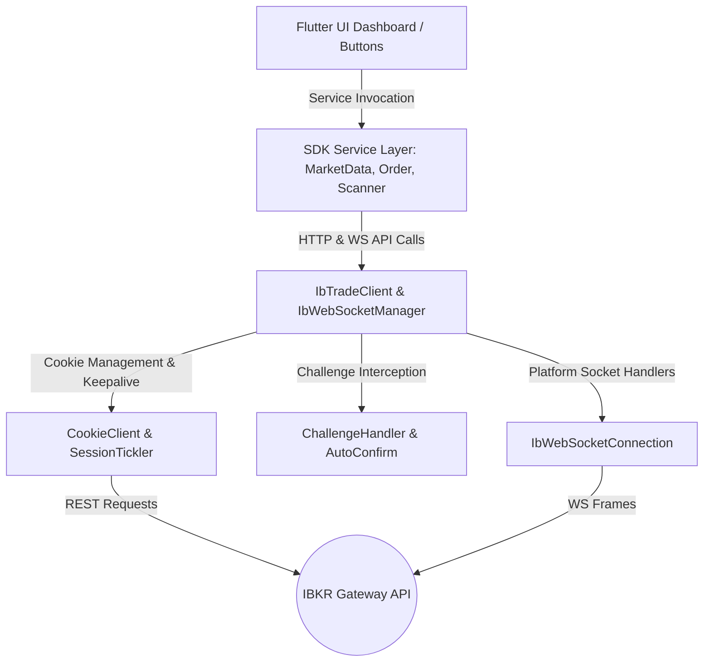

# Interactive Brokers Trading SDK for Dart & Flutter

A high-performance, cross-platform Dart & Flutter SDK for interacting with the **Interactive Brokers (IBKR) Client Portal Gateway**. 

This SDK is divided into two modules:
1. **`ib_trade_core`**: The foundational networking and protocol layer (Session tracking, HTTP cookie jar, WebSocket reconnects, and Automatic Challenge/Compliance resolution).
2. **`ib_trade_dart`**: The high-level developer-facing service layer (Market data snapshots, real-time streams, orders, portfolio, and scanner services).

---

## Architecture Overview



---

## UI Button Interaction Map

Below is a detailed trace of how typical trading dashboard UI buttons map to code executions: from the button callback, through the SDK service, to the core transport logic, and finally to the gateway REST/WS endpoints.

### 1. `Connect Gateway` Button
*   **UI Trigger Action:** User clicks the **"Connect Gateway"** button to start real-time streams.
*   **UI Code Example:**
    ```dart
    onPressed: () async {
      await wsManager.connect();
    }
    ```
*   **SDK Method / Function:** `IbWebSocketManager.connect` (located in [lib/src/websocket/ib_websocket_manager.dart](https://github.com/Aloshanai/ib_trade_dart/blob/main/lib/src/websocket/ib_websocket_manager.dart#L58-L60))
*   **Core Method / Function:** `IbWebSocketConnection.connect` (located in [lib/src/client/websocket_connection.dart](https://github.com/Aloshanai/ib_trade_core/blob/main/lib/src/client/websocket_connection.dart#L74-L78) of `ib_trade_core`) $\rightarrow$ delegates to the factory function `connectWebSocket` (located in [lib/src/client/websocket_impl.dart](https://github.com/Aloshanai/ib_trade_core/blob/main/lib/src/client/websocket_impl.dart) of `ib_trade_core`).
*   **Gateway Target:** `wss://localhost:5000/v1/api/ws` (WebSocket connection endpoint)
*   **Execution Flow:**
    1. The UI button calls the `connect()` function in `IbWebSocketManager`.
    2. `IbWebSocketManager` calls the low-level `_connection.connect()` in `IbWebSocketConnection`.
    3. `IbWebSocketConnection` updates connection state to `IbWebSocketState.connecting`.
    4. It reads active session cookies from the getter `CookieClient.cookies` (located in [lib/src/client/cookie_client.dart](https://github.com/Aloshanai/ib_trade_core/blob/main/lib/src/client/cookie_client.dart#L15) of `ib_trade_core`) and appends them to the WebSocket connection headers as `Cookie: ...`.
    5. It executes `connectWebSocket()` which uses VM-specific (`websocket_impl_io.dart`) or web-specific (`websocket_impl_web.dart`) bindings to establish the socket.
    6. On success, state becomes `IbWebSocketState.connected`. A background periodic timer fires a `tickle` string frame every 45 seconds to keep the socket alive.

---

### 2. `Check Auth Status` Button
*   **UI Trigger Action:** User opens the application or clicks **"Verify Authentication"** to check if the session is validated.
*   **UI Code Example:**
    ```dart
    onPressed: () async {
      final status = await client.checkAuthStatus();
      setState(() => _authenticated = status.authenticated);
    }
    ```
*   **SDK Method / Function:** `IbTradeClient.checkAuthStatus` (located in [lib/src/client/ib_trade_client.dart](https://github.com/Aloshanai/ib_trade_dart/blob/main/lib/src/client/ib_trade_client.dart#L52-L63))
*   **Core Method / Function:** `IbTradeClient.get` helper (located in [lib/src/client/ib_trade_client.dart](https://github.com/Aloshanai/ib_trade_dart/blob/main/lib/src/client/ib_trade_client.dart#L102-L118)) $\rightarrow$ delegates to the underlying `CookieClient.get` (located in [lib/src/client/cookie_client.dart](https://github.com/Aloshanai/ib_trade_core/blob/main/lib/src/client/cookie_client.dart) of `ib_trade_core`).
*   **Gateway Target:** `GET /iserver/auth/status`
*   **Execution Flow:**
    1. UI calls `checkAuthStatus()` which performs a REST `GET` request relative to the gateway config.
    2. The request is processed by `CookieClient`, appending the current session cookie (`rekey`, `JSESSIONID`, etc.).
    3. The gateway returns a JSON payload containing authentication flags.
    4. If response code is `200`, the JSON is parsed into an `AuthStatus` object and returned to the UI. If not, an `IbException` is thrown.

---

### 3. `Start Session Keeper` Button / Switch
*   **UI Trigger Action:** User toggles a switch to run keep-alive pings in the background.
*   **UI Code Example:**
    ```dart
    onChanged: (enabled) {
      enabled ? client.startSessionTickler() : client.stopSessionTickler();
    }
    ```
*   **SDK Method / Function:** `IbTradeClient.startSessionTickler` (located in [lib/src/client/ib_trade_client.dart](https://github.com/Aloshanai/ib_trade_dart/blob/main/lib/src/client/ib_trade_client.dart#L66-L68))
*   **Core Method / Function:** `SessionTickler.start` (located in [lib/src/client/session_tickler.dart](https://github.com/Aloshanai/ib_trade_core/blob/main/lib/src/client/session_tickler.dart#L28-L33) of `ib_trade_core`)
*   **Gateway Target:** `GET /tickle`
*   **Execution Flow:**
    1. UI calls `startSessionTickler()`, which invokes `SessionTickler.start()`.
    2. The tickler fires an immediate asynchronous keepalive request to `/tickle`.
    3. A periodic `Timer` triggers the request again every 45 seconds.
    4. Incoming response cookies (`set-cookie` header) are captured by `CookieClient` to renew the local cookie jar automatically.

---

### 4. `Get Price Snapshot` Button
*   **UI Trigger Action:** User clicks **"Refresh Price"** on a static watchlist item.
*   **UI Code Example:**
    ```dart
    onPressed: () async {
      final list = await marketDataService.getSnapshot([265598]); // conid for AAPL
      setState(() => _price = list.first.last);
    }
    ```
*   **SDK Method / Function:** `MarketDataService.getSnapshot` (located in [lib/src/market_data/market_data_service.dart](https://github.com/Aloshanai/ib_trade_dart/blob/main/lib/src/market_data/market_data_service.dart#L31-L61))
*   **Core Method / Function:** `IbTradeClient.get` helper (located in [lib/src/client/ib_trade_client.dart](https://github.com/Aloshanai/ib_trade_dart/blob/main/lib/src/client/ib_trade_client.dart#L102-L118)) $\rightarrow$ delegates to the underlying `CookieClient.get` (located in [lib/src/client/cookie_client.dart](https://github.com/Aloshanai/ib_trade_core/blob/main/lib/src/client/cookie_client.dart) of `ib_trade_core`).
*   **Gateway Target:** `GET /iserver/marketdata/snapshot?conids=265598`
*   **Execution Flow:**
    1. UI triggers `getSnapshot()`, which joins contract IDs with commas.
    2. It executes a query parameters-enriched REST `GET` request through the `IbTradeClient`.
    3. The JSON response (an array of ticker property-value pairs) is decoded and mapped into `MarketDataSnapshot` objects.

---

### 5. `Subscribe Real-Time Ticks` Switch
*   **UI Trigger Action:** User clicks **"Stream Market Data"** to listen to live ticks.
*   **UI Code Example:**
    ```dart
    onChanged: (active) {
      if (active) {
        marketDataService.subscribeMarketData([265598]);
      } else {
        marketDataService.unsubscribeMarketData([265598]);
      }
    }
    ```
*   **SDK Method / Function:** `MarketDataService.subscribeMarketData` (located in [lib/src/market_data/market_data_service.dart](https://github.com/Aloshanai/ib_trade_dart/blob/main/lib/src/market_data/market_data_service.dart#L64-L70))
*   **Core Method / Function:** `IbWebSocketManager.subscribeMarketData` (located in [lib/src/websocket/ib_websocket_manager.dart](https://github.com/Aloshanai/ib_trade_dart/blob/main/lib/src/websocket/ib_websocket_manager.dart#L98-L108)) $\rightarrow$ delegates to `IbWebSocketConnection.send` (located in [lib/src/client/websocket_connection.dart](https://github.com/Aloshanai/ib_trade_core/blob/main/lib/src/client/websocket_connection.dart#L200-L206) of `ib_trade_core`).
*   **Gateway Target:** WebSocket frame text `'smd+265598+{"fields":[]}'`
*   **Execution Flow:**
    1. UI calls `subscribeMarketData()`, which requests the `IbWebSocketManager` to transmit a subscription command.
    2. The manager converts this to the IBKR WebSocket command format `smd+{conid}+{json_fields_string}`.
    3. `IbWebSocketConnection` validates that the socket is connected, and sends the string payload.
    4. Incoming real-time market ticks match the `smd+` topic key, prompting `IbWebSocketManager` to parse and push them down `marketDataStream` (located in [lib/src/websocket/ib_websocket_manager.dart](https://github.com/Aloshanai/ib_trade_dart/blob/main/lib/src/websocket/ib_websocket_manager.dart#L49)) for the UI to consume.

---

### 6. `Run Market Scanner` Button
*   **UI Trigger Action:** User clicks **"Find Gainers"** to execute a stock scan filter.
*   **UI Code Example:**
    ```dart
    onPressed: () async {
      final req = ScannerRequest(instrument: 'STK', type: 'TOP_PERC_GAIN', location: 'STK.US.MAJOR');
      final list = await scannerService.runScanner(req);
      setState(() => _scannedStocks = list);
    }
    ```
*   **SDK Method / Function:** `ScannerService.runScanner` (located in [lib/src/scanner/scanner_service.dart](https://github.com/Aloshanai/ib_trade_dart/blob/main/lib/src/scanner/scanner_service.dart#L29-L51))
*   **Core Method / Function:** `IbTradeClient.post` (located in [lib/src/client/ib_trade_client.dart](https://github.com/Aloshanai/ib_trade_dart/blob/main/lib/src/client/ib_trade_client.dart#L123-L157)) $\rightarrow$ delegates to the underlying `CookieClient.post` (located in [lib/src/client/cookie_client.dart](https://github.com/Aloshanai/ib_trade_core/blob/main/lib/src/client/cookie_client.dart) of `ib_trade_core`).
*   **Gateway Target:** `POST /iserver/scanner/run`
*   **Execution Flow:**
    1. UI calls `runScanner()` which serializes the `ScannerRequest` object.
    2. `IbTradeClient` transmits a POST request to `/iserver/scanner/run`.
    3. The array response payload containing rankings, tickers, and prices is parsed into a `List<ScannerResult>` where the rank index is appended to each item.

---

### 7. `Submit Order` Button (BUY/SELL)
*   **UI Trigger Action:** User clicks **"Submit Trade"** or **"Buy Shares"**.
*   **UI Code Example:**
    ```dart
    onPressed: () async {
      final req = OrderRequest(acctId: 'U1234567', conid: 265598, orderType: OrderType.limit, side: OrderSide.buy, quantity: 50, price: 175.5);
      final status = await orderService.placeOrder('U1234567', req);
      print('Order placed: ${status.first.status}');
    }
    ```
*   **SDK Method / Function:** `OrderService.placeOrder` (located in [lib/src/orders/order_service.dart](https://github.com/Aloshanai/ib_trade_dart/blob/main/lib/src/orders/order_service.dart#L18-L40))
*   **Core Method / Function:** `IbTradeClient.post` (located in [lib/src/client/ib_trade_client.dart](https://github.com/Aloshanai/ib_trade_dart/blob/main/lib/src/client/ib_trade_client.dart#L123-L157)) $\rightarrow$ delegates to `ChallengeHandler.handleChallenge` (located in [lib/src/client/challenge_handler.dart](https://github.com/Aloshanai/ib_trade_core/blob/main/lib/src/client/challenge_handler.dart#L89-L98) of `ib_trade_core`).
*   **Gateway Target:** `POST /iserver/account/U1234567/orders`
*   **Execution Flow:**
    1. UI calls `placeOrder()` which wraps the order details inside a payload structure containing `'orders': [...]`.
    2. It calls `IbTradeClient.post()`.
    3. **Challenge Check:** If the gateway returns a compliance challenge (e.g. asking the user to confirm trading outside regular hours or confirming risks), the client intercepts it.
    4. `ChallengeHandler` (located in [lib/src/client/challenge_handler.dart](https://github.com/Aloshanai/ib_trade_core/blob/main/lib/src/client/challenge_handler.dart#L60) of `ib_trade_core`) iterates through registered resolvers. By default, it automatically confirms the challenge and replies to `POST /iserver/reply/{challengeId}` with `{"confirmed": true}`.
    5. After resolving, the client automatically retries the initial POST request.
    6. The final array of order statuses is parsed into `List<OrderStatus>` and returned.

---

### 8. `Cancel Order` Button
*   **UI Trigger Action:** User clicks **"Cancel"** next to a pending order in their list.
*   **UI Code Example:**
    ```dart
    onPressed: () async {
      final success = await orderService.cancelOrder('U1234567', '987654321');
      if (success) _refreshOrders();
    }
    ```
*   **SDK Method / Function:** `OrderService.cancelOrder` (located in [lib/src/orders/order_service.dart](https://github.com/Aloshanai/ib_trade_dart/blob/main/lib/src/orders/order_service.dart#L74-L81))
*   **Core Method / Function:** `IbTradeClient.delete` (located in [lib/src/client/ib_trade_client.dart](https://github.com/Aloshanai/ib_trade_dart/blob/main/lib/src/client/ib_trade_client.dart#L160-L171)) $\rightarrow$ delegates to `CookieClient.delete` (located in [lib/src/client/cookie_client.dart](https://github.com/Aloshanai/ib_trade_core/blob/main/lib/src/client/cookie_client.dart) of `ib_trade_core`).
*   **Gateway Target:** `DELETE /iserver/account/U1234567/order/987654321`
*   **Execution Flow:**
    1. UI calls `cancelOrder()` which initiates a REST `DELETE` request with the accounts and orders parameters.
    2. On receiving a HTTP `200` response from the gateway, it returns `true` indicating the cancellation request was logged.

---

### 9. `Get Positions` Button
*   **UI Trigger Action:** User clicks the **"Portfolio"** tab in the dashboard navigation.
*   **UI Code Example:**
    ```dart
    onPressed: () async {
      final list = await orderService.getPositions('U1234567');
      setState(() => _positions = list);
    }
    ```
*   **SDK Method / Function:** `OrderService.getPositions` (located in [lib/src/orders/order_service.dart](https://github.com/Aloshanai/ib_trade_dart/blob/main/lib/src/orders/order_service.dart#L110-L125))
*   **Core Method / Function:** `IbTradeClient.get` (located in [lib/src/client/ib_trade_client.dart](https://github.com/Aloshanai/ib_trade_dart/blob/main/lib/src/client/ib_trade_client.dart#L102-L118)) $\rightarrow$ delegates to `CookieClient.get` (located in [lib/src/client/cookie_client.dart](https://github.com/Aloshanai/ib_trade_core/blob/main/lib/src/client/cookie_client.dart) of `ib_trade_core`).
*   **Gateway Target:** `GET /portfolio/U1234567/positions/0`
*   **Execution Flow:**
    1. UI calls `getPositions()` which performs a GET request for a specific portfolio page (defaults to page `0`).
    2. The list of active holdings is returned by the gateway.
    3. The SDK parses JSON elements (position sizes, market value, unrealized PnL) into `Position` instances.

---

### 10. `Subscribe Account Summary` Switch
*   **UI Trigger Action:** User opens their dashboard page and wants live balance updates.
*   **UI Code Example:**
    ```dart
    onChanged: (active) {
      if (active) {
        wsManager.subscribeAccount();
      } else {
        wsManager.unsubscribeAccount();
      }
    }
    ```
*   **SDK Method / Function:** `IbWebSocketManager.subscribeAccount` (located in [lib/src/websocket/ib_websocket_manager.dart](https://github.com/Aloshanai/ib_trade_dart/blob/main/lib/src/websocket/ib_websocket_manager.dart#L128-L130))
*   **Core Method / Function:** `IbWebSocketConnection.send` (located in [lib/src/client/websocket_connection.dart](https://github.com/Aloshanai/ib_trade_core/blob/main/lib/src/client/websocket_connection.dart#L200-L206) of `ib_trade_core`)
*   **Gateway Target:** WebSocket frame text `'sact+{}'`
*   **Execution Flow:**
    1. UI calls `subscribeAccount()`, which calls the core socket layer to transmit `'sact+{}'`.
    2. Incoming frames prefixed with topic `sact` (or containing fields like `netLiquidation`) are captured by the parser in `IbWebSocketManager._parseAndDispatch`.
    3. The manager serializes these frames into `AccountSummary` updates and broadcasts them to the `accountSummaryStream` (located in [lib/src/websocket/ib_websocket_manager.dart](https://github.com/Aloshanai/ib_trade_dart/blob/main/lib/src/websocket/ib_websocket_manager.dart#L55)).

---

## Detailed Data Flows

### HTTP Challenge Resolution Cycle (Order Placement Example)

```mermaid
sequenceDiagram
    autonumber
    participant UI as Flutter UI
    participant Service as OrderService
    participant Client as IbTradeClient
    participant Handler as ChallengeHandler
    participant Jar as CookieClient
    participant Gateway as IBKR Gateway

    UI->>Service: placeOrder(acctId, OrderRequest)
    Service->>Client: post('iserver/account/.../orders', body)
    Client->>Jar: post(uri, headers, body)
    Note over Jar: Inject session cookies
    Jar->>Gateway: POST /iserver/account/{acctId}/orders
    Gateway-->>Jar: HTTP 200 [{'id': 'challenge_1', 'type': 'warning', 'message': 'Confirm RTH'}]
    Jar-->>Client: Response (Contains Challenge JSON)
    
    rect rgb(30, 30, 46)
        Note over Client: Challenge Detected!
        Client->>Handler: handleChallenge(challenge)
        Handler->>Handler: Resolve (AutoConfirm -> true)
        Handler->>Jar: post('/iserver/reply/challenge_1', '{"confirmed": true}')
        Jar->>Gateway: POST /iserver/reply/challenge_1
        Gateway-->>Jar: HTTP 200 {"status": "ok"}
        Jar-->>Handler: True (Challenge cleared)
    end

    Client->>Jar: Retry original post(uri, headers, body)
    Jar->>Gateway: POST /iserver/account/{acctId}/orders
    Gateway-->>Jar: HTTP 200 [{"order_id": "123", "status": "Submitted"}]
    Jar-->>Client: Response (Successful Order Placement)
    Client-->>Service: List<OrderStatus>
    Service-->>UI: List<OrderStatus> (Display Order Status)
```



### WebSocket Dispatch Loop

```mermaid
sequenceDiagram
    autonumber
    participant Gateway as IBKR Gateway
    participant Conn as IbWebSocketConnection
    participant Manager as IbWebSocketManager
    participant UI as Watchers / Streams

    Gateway->>Conn: Raw WS Frame (Text)
    Conn->>Manager: Push to message stream
    
    rect rgb(35, 45, 35)
        Note over Manager: Parse Frame topic & JSON
        alt topic starts with 'smd+' or contains '_field'
            Manager->>UI: marketDataStream (MarketDataTick)
        else topic starts with 'sor' or contains 'orderId'
            Manager->>UI: orderStatusStream (OrderStatus)
        else topic starts with 'sact' or contains 'netLiquidation'
            Manager->>UI: accountSummaryStream (AccountSummary)
        end
    end
```



---

## SDK Module Function Reference

### 1. `ib_trade_dart`

#### `IbTradeClient`
*   **Constructor:** `IbTradeClient({GatewayConfig? config, HttpClient? httpClient, CookieClient? cookieClient, SessionTickler? sessionTickler, ChallengeHandler? challengeHandler})`  
    *   **Location:** [lib/src/client/ib_trade_client.dart:L28-L47](https://github.com/Aloshanai/ib_trade_dart/blob/main/lib/src/client/ib_trade_client.dart#L28-L47)
    *   **Description:** Instantiates the central high-level client. Sets up default cookie client, session tickler, and challenge-handling instances if they are not explicitly injected.
*   **`Future<AuthStatus> checkAuthStatus()`**  
    *   **Location:** [lib/src/client/ib_trade_client.dart:L52-L63](https://github.com/Aloshanai/ib_trade_dart/blob/main/lib/src/client/ib_trade_client.dart#L52-L63)
    *   **Description:** Queries the current authentication status of the gateway session. Throws `IbException` on non-200 responses.
*   **`void startSessionTickler()`**  
    *   **Location:** [lib/src/client/ib_trade_client.dart:L66-L68](https://github.com/Aloshanai/ib_trade_dart/blob/main/lib/src/client/ib_trade_client.dart#L66-L68)
    *   **Description:** Begins background polling of the gateway's `/tickle` endpoint to prevent connection time-outs.
*   **`void stopSessionTickler()`**  
    *   **Location:** [lib/src/client/ib_trade_client.dart:L71-L73](https://github.com/Aloshanai/ib_trade_dart/blob/main/lib/src/client/ib_trade_client.dart#L71-L73)
    *   **Description:** Halts the session-tickling timer.
*   **`Future<http.Response> get(String endpoint, {Map<String, String>? headers, Map<String, dynamic>? queryParameters})`**  
    *   **Location:** [lib/src/client/ib_trade_client.dart:L102-L118](https://github.com/Aloshanai/ib_trade_dart/blob/main/lib/src/client/ib_trade_client.dart#L102-L118)
    *   **Description:** Executes a session-cookie-authenticated HTTP GET request relative to the gateway's base URI.
*   **`Future<http.Response> post(String endpoint, {dynamic body, Map<String, String>? headers, bool autoHandleChallenges = true})`**  
    *   **Location:** [lib/src/client/ib_trade_client.dart:L123-L157](https://github.com/Aloshanai/ib_trade_dart/blob/main/lib/src/client/ib_trade_client.dart#L123-L157)
    *   **Description:** Executes an HTTP POST request relative to the gateway's base URI. When `autoHandleChallenges` is true, intercepts and confirms compliance alerts, then retries the request.
*   **`Future<http.Response> delete(String endpoint, {Map<String, String>? headers})`**  
    *   **Location:** [lib/src/client/ib_trade_client.dart:L160-L171](https://github.com/Aloshanai/ib_trade_dart/blob/main/lib/src/client/ib_trade_client.dart#L160-L171)
    *   **Description:** Executes an HTTP DELETE request relative to the gateway's base URI.
*   **`Future<http.Response> resolveChallengesAndRetry(dynamic responseJson, Future<http.Response> Function() retryAction)`**  
    *   **Location:** [lib/src/client/ib_trade_client.dart:L76-L99](https://github.com/Aloshanai/ib_trade_dart/blob/main/lib/src/client/ib_trade_client.dart#L76-L99)
    *   **Description:** Parses challenge warnings from responses, executes confirmation replies, and performs the original request retry action.
*   **`void close()`**  
    *   **Location:** [lib/src/client/ib_trade_client.dart:L174-L177](https://github.com/Aloshanai/ib_trade_dart/blob/main/lib/src/client/ib_trade_client.dart#L174-L177)
    *   **Description:** Halts keep-alive timers and releases resources held by underlying clients.

#### `MarketDataService`
*   **Constructor:** `MarketDataService(IbTradeClient client, {IbWebSocketManager? wsManager})`  
    *   **Location:** [lib/src/market_data/market_data_service.dart:L12-L15](https://github.com/Aloshanai/ib_trade_dart/blob/main/lib/src/market_data/market_data_service.dart#L12-L15)
    *   **Description:** Binds REST client and WebSocket manager to process price updates.
*   **`Stream<MarketDataTick> get ticksStream`**  
    *   **Location:** [lib/src/market_data/market_data_service.dart:L18-L24](https://github.com/Aloshanai/ib_trade_dart/blob/main/lib/src/market_data/market_data_service.dart#L18-L24)
    *   **Description:** Exposes a broadcast stream for real-time market ticks. Requires a connected `IbWebSocketManager`.
*   **`Future<List<MarketDataSnapshot>> getSnapshot(List<int> conids, {List<String>? fields})`**  
    *   **Location:** [lib/src/market_data/market_data_service.dart:L31-L61](https://github.com/Aloshanai/ib_trade_dart/blob/main/lib/src/market_data/market_data_service.dart#L31-L61)
    *   **Description:** Queries static snapshot details (Bid, Ask, Last) for contract IDs via HTTP.
*   **`void subscribeMarketData(List<int> conids, {List<String>? fields})`**  
    *   **Location:** [lib/src/market_data/market_data_service.dart:L64-L70](https://github.com/Aloshanai/ib_trade_dart/blob/main/lib/src/market_data/market_data_service.dart#L64-L70)
    *   **Description:** Transmits subscription commands for contract IDs over the WebSocket.
*   **`void unsubscribeMarketData(List<int> conids)`**  
    *   **Location:** [lib/src/market_data/market_data_service.dart:L73-L79](https://github.com/Aloshanai/ib_trade_dart/blob/main/lib/src/market_data/market_data_service.dart#L73-L79)
    *   **Description:** Sends unsubscription commands over the WebSocket to stop tracking contract IDs.

#### `OrderService`
*   **Constructor:** `OrderService(IbTradeClient client)`  
    *   **Location:** [lib/src/orders/order_service.dart:L11](https://github.com/Aloshanai/ib_trade_dart/blob/main/lib/src/orders/order_service.dart#L11)
    *   **Description:** Instantiates the order management service.
*   **`Future<List<OrderStatus>> placeOrder(String acctId, OrderRequest request)`**  
    *   **Location:** [lib/src/orders/order_service.dart:L18-L40](https://github.com/Aloshanai/ib_trade_dart/blob/main/lib/src/orders/order_service.dart#L18-L40)
    *   **Description:** Places an order on a given account. Automatically intercepts challenges and executes confirmations.
*   **`Future<List<OrderStatus>> modifyOrder(String acctId, String orderId, OrderRequest request)`**  
    *   **Location:** [lib/src/orders/order_service.dart:L45-L69](https://github.com/Aloshanai/ib_trade_dart/blob/main/lib/src/orders/order_service.dart#L45-L69)
    *   **Description:** Updates parameters (price, volume) of an active open order.
*   **`Future<bool> cancelOrder(String acctId, String orderId)`**  
    *   **Location:** [lib/src/orders/order_service.dart:L74-L81](https://github.com/Aloshanai/ib_trade_dart/blob/main/lib/src/orders/order_service.dart#L74-L81)
    *   **Description:** Requests cancellation of a pending order. Returns `true` on success.
*   **`Future<List<OrderStatus>> getOpenOrders()`**  
    *   **Location:** [lib/src/orders/order_service.dart:L86-L105](https://github.com/Aloshanai/ib_trade_dart/blob/main/lib/src/orders/order_service.dart#L86-L105)
    *   **Description:** Fetches all active pending orders across trading accounts.
*   **`Future<List<Position>> getPositions(String acctId, {int page = 0})`**  
    *   **Location:** [lib/src/orders/order_service.dart:L110-L125](https://github.com/Aloshanai/ib_trade_dart/blob/main/lib/src/orders/order_service.dart#L110-L125)
    *   **Description:** Queries active portfolio positions page-by-page.
*   **`Future<AccountSummary> getAccountSummary(String acctId)`**  
    *   **Location:** [lib/src/orders/order_service.dart:L130-L142](https://github.com/Aloshanai/ib_trade_dart/blob/main/lib/src/orders/order_service.dart#L130-L142)
    *   **Description:** Queries current buying power, cash balances, and equity metrics.

#### `ScannerService`
*   **Constructor:** `ScannerService(IbTradeClient client)`  
    *   **Location:** [lib/src/scanner/scanner_service.dart:L10](https://github.com/Aloshanai/ib_trade_dart/blob/main/lib/src/scanner/scanner_service.dart#L10)
    *   **Description:** Instantiates the scanner configuration and query runner service.
*   **`Future<ScannerParams> getScannerParams()`**  
    *   **Location:** [lib/src/scanner/scanner_service.dart:L15-L24](https://github.com/Aloshanai/ib_trade_dart/blob/main/lib/src/scanner/scanner_service.dart#L15-L24)
    *   **Description:** Fetches the lists of valid scanner regions, parameters, and filter types from the gateway.
*   **`Future<List<ScannerResult>> runScanner(ScannerRequest request)`**  
    *   **Location:** [lib/src/scanner/scanner_service.dart:L29-L51](https://github.com/Aloshanai/ib_trade_dart/blob/main/lib/src/scanner/scanner_service.dart#L29-L51)
    *   **Description:** Executes a custom scanner configuration query and returns ranking results.

#### `IbWebSocketManager`
*   **Constructor:** `IbWebSocketManager({GatewayConfig? config, IbWebSocketConnection? connection, CookieClient? cookieClient})`  
    *   **Location:** [lib/src/websocket/ib_websocket_manager.dart:L27-L40](https://github.com/Aloshanai/ib_trade_dart/blob/main/lib/src/websocket/ib_websocket_manager.dart#L27-L40)
    *   **Description:** Establishes a high-level WebSocket parser. Handles raw frame decoding and topic-based dispatching.
*   **`Stream<IbWebSocketState> get stateChanges`**  
    *   **Location:** [lib/src/websocket/ib_websocket_manager.dart:L43](https://github.com/Aloshanai/ib_trade_dart/blob/main/lib/src/websocket/ib_websocket_manager.dart#L43)
    *   **Description:** Stream of active states (`connecting`, `connected`, `disconnected`, `reconnecting`).
*   **`IbWebSocketState get state`**  
    *   **Location:** [lib/src/websocket/ib_websocket_manager.dart:L46](https://github.com/Aloshanai/ib_trade_dart/blob/main/lib/src/websocket/ib_websocket_manager.dart#L46)
    *   **Description:** Exposes the current state of the socket connection.
*   **`Stream<MarketDataTick> get marketDataStream`**  
    *   **Location:** [lib/src/websocket/ib_websocket_manager.dart:L49](https://github.com/Aloshanai/ib_trade_dart/blob/main/lib/src/websocket/ib_websocket_manager.dart#L49)
    *   **Description:** Broadcast stream emitting parsed ticker events.
*   **`Stream<OrderStatus> get orderStatusStream`**  
    *   **Location:** [lib/src/websocket/ib_websocket_manager.dart:L52](https://github.com/Aloshanai/ib_trade_dart/blob/main/lib/src/websocket/ib_websocket_manager.dart#L52)
    *   **Description:** Broadcast stream emitting parsed order updates.
*   **`Stream<AccountSummary> get accountSummaryStream`**  
    *   **Location:** [lib/src/websocket/ib_websocket_manager.dart:L55](https://github.com/Aloshanai/ib_trade_dart/blob/main/lib/src/websocket/ib_websocket_manager.dart#L55)
    *   **Description:** Broadcast stream emitting parsed account balance events.
*   **`Future<void> connect()`**  
    *   **Location:** [lib/src/websocket/ib_websocket_manager.dart:L58-L60](https://github.com/Aloshanai/ib_trade_dart/blob/main/lib/src/websocket/ib_websocket_manager.dart#L58-L60)
    *   **Description:** Triggers the low-level connection handshake process.
*   **`Future<void> disconnect()`**  
    *   **Location:** [lib/src/websocket/ib_websocket_manager.dart:L63-L65](https://github.com/Aloshanai/ib_trade_dart/blob/main/lib/src/websocket/ib_websocket_manager.dart#L63-L65)
    *   **Description:** Disconnects the socket and disables auto-reconnect logic.
*   **`void subscribeMarketData(List<int> conids, {List<String>? fields})`**  
    *   **Location:** [lib/src/websocket/ib_websocket_manager.dart:L101-L108](https://github.com/Aloshanai/ib_trade_dart/blob/main/lib/src/websocket/ib_websocket_manager.dart#L101-L108)
    *   **Description:** Transmits an smd command subscription frame.
*   **`void unsubscribeMarketData(List<int> conids)`**  
    *   **Location:** [lib/src/websocket/ib_websocket_manager.dart:L111-L115](https://github.com/Aloshanai/ib_trade_dart/blob/main/lib/src/websocket/ib_websocket_manager.dart#L111-L115)
    *   **Description:** Transmits a umd command unsubscription frame.
*   **`void subscribeOrders()`**  
    *   **Location:** [lib/src/websocket/ib_websocket_manager.dart:L118-L120](https://github.com/Aloshanai/ib_trade_dart/blob/main/lib/src/websocket/ib_websocket_manager.dart#L118-L120)
    *   **Description:** Subscribes to live execution and order status broadcasts (`sor+{}`).
*   **`void unsubscribeOrders()`**  
    *   **Location:** [lib/src/websocket/ib_websocket_manager.dart:L123-L125](https://github.com/Aloshanai/ib_trade_dart/blob/main/lib/src/websocket/ib_websocket_manager.dart#L123-L125)
    *   **Description:** Unsubscribes from live order status broadcasts (`uor+{}`).
*   **`void subscribeAccount()`**  
    *   **Location:** [lib/src/websocket/ib_websocket_manager.dart:L128-L130](https://github.com/Aloshanai/ib_trade_dart/blob/main/lib/src/websocket/ib_websocket_manager.dart#L128-L130)
    *   **Description:** Subscribes to real-time account metric updates (`sact+{}`).
*   **`void unsubscribeAccount()`**  
    *   **Location:** [lib/src/websocket/ib_websocket_manager.dart:L133-L135](https://github.com/Aloshanai/ib_trade_dart/blob/main/lib/src/websocket/ib_websocket_manager.dart#L133-L135)
    *   **Description:** Unsubscribes from account updates (`uact+{}`).
*   **`Future<void> close()`**  
    *   **Location:** [lib/src/websocket/ib_websocket_manager.dart:L138-L144](https://github.com/Aloshanai/ib_trade_dart/blob/main/lib/src/websocket/ib_websocket_manager.dart#L138-L144)
    *   **Description:** Disconnects and closes all internal broadcast controllers.

---

### 2. `ib_trade_core`

#### `GatewayConfig`
*   **Constructor:** `GatewayConfig({String host, int port, bool useSsl, bool bypassSslVerification, int tickleIntervalSeconds})`  
    *   **Location:** [lib/src/config/gateway_config.dart:L26-L32](https://github.com/Aloshanai/ib_trade_core/blob/main/lib/src/config/gateway_config.dart#L26-L32)
    *   **Description:** Maintains gateway configurations (defaults to `localhost:5000`).
*   **`Uri get baseHttpUri`**  
    *   **Location:** [lib/src/config/gateway_config.dart:L35-L42](https://github.com/Aloshanai/ib_trade_core/blob/main/lib/src/config/gateway_config.dart#L35-L42)
    *   **Description:** Constructs the base URL path for REST endpoints.
*   **`Uri get baseWsUri`**  
    *   **Location:** [lib/src/config/gateway_config.dart:L45-L53](https://github.com/Aloshanai/ib_trade_core/blob/main/lib/src/config/gateway_config.dart#L45-L53)
    *   **Description:** Constructs the base URL path for WebSocket endpoints.
*   **`factory GatewayConfig.fromEnvironment()`**  
    *   **Location:** [lib/src/config/gateway_config.dart:L56-L66](https://github.com/Aloshanai/ib_trade_core/blob/main/lib/src/config/gateway_config.dart#L56-L66)
    *   **Description:** Instantiates configuration parameters using environment variables (e.g. `IB_GATEWAY_HOST`).

#### `CookieClient`
*   **Constructor:** `CookieClient(http.Client inner)`  
    *   **Location:** [lib/src/client/cookie_client.dart:L12](https://github.com/Aloshanai/ib_trade_core/blob/main/lib/src/client/cookie_client.dart#L12)
    *   **Description:** A stateful wrapper extending `http.BaseClient`.
*   **`Map<String, String> get cookies`**  
    *   **Location:** [lib/src/client/cookie_client.dart:L15](https://github.com/Aloshanai/ib_trade_core/blob/main/lib/src/client/cookie_client.dart#L15)
    *   **Description:** Exposes current stored key-value cookies.
*   **`void clearCookies()`**  
    *   **Location:** [lib/src/client/cookie_client.dart:L18-L20](https://github.com/Aloshanai/ib_trade_core/blob/main/lib/src/client/cookie_client.dart#L18-L20)
    *   **Description:** Clears all saved cookies from the session jar.
*   **`Future<http.StreamedResponse> send(http.BaseRequest request)`**  
    *   **Location:** [lib/src/client/cookie_client.dart:L23-L45](https://github.com/Aloshanai/ib_trade_core/blob/main/lib/src/client/cookie_client.dart#L23-L45)
    *   **Description:** Intercepts outbound HTTP requests to append cookie headers, and scans inbound HTTP headers for `Set-Cookie` updates to maintain session state.

#### `SessionTickler`
*   **Constructor:** `SessionTickler(http.Client client, Uri baseUrl, {Duration interval})`  
    *   **Location:** [lib/src/client/session_tickler.dart:L15-L19](https://github.com/Aloshanai/ib_trade_core/blob/main/lib/src/client/session_tickler.dart#L15-L19)
    *   **Description:** Configures timer parameters for keeper pings.
*   **`bool get isActive`**  
    *   **Location:** [lib/src/client/session_tickler.dart:L22](https://github.com/Aloshanai/ib_trade_core/blob/main/lib/src/client/session_tickler.dart#L22)
    *   **Description:** True if the background tickle loop timer is running.
*   **`void start()`**  
    *   **Location:** [lib/src/client/session_tickler.dart:L28-L33](https://github.com/Aloshanai/ib_trade_core/blob/main/lib/src/client/session_tickler.dart#L28-L33)
    *   **Description:** Fires an immediate keep-alive ping and starts the periodic interval timer.
*   **`void stop()`**  
    *   **Location:** [lib/src/client/session_tickler.dart:L36-L40](https://github.com/Aloshanai/ib_trade_core/blob/main/lib/src/client/session_tickler.dart#L36-L40)
    *   **Description:** Cancels the active interval timer.

#### `ChallengeHandler`
*   **Constructor:** `ChallengeHandler(http.Client client, Uri baseUrl)`  
    *   **Location:** [lib/src/client/challenge_handler.dart:L66-L69](https://github.com/Aloshanai/ib_trade_core/blob/main/lib/src/client/challenge_handler.dart#L66-L69)
    *   **Description:** Instantiates challenge controllers. Automatically registers an `AutoConfirmChallengeResolver`.
*   **`void registerResolver(ChallengeResolver resolver)`**  
    *   **Location:** [lib/src/client/challenge_handler.dart:L76-L78](https://github.com/Aloshanai/ib_trade_core/blob/main/lib/src/client/challenge_handler.dart#L76-L78)
    *   **Description:** Registers a custom resolver (e.g., to prompt user popups instead of automatically confirming).
*   **`void unregisterResolver(ChallengeResolver resolver)`**  
    *   **Location:** [lib/src/client/challenge_handler.dart:L81-L83](https://github.com/Aloshanai/ib_trade_core/blob/main/lib/src/client/challenge_handler.dart#L81-L83)
    *   **Description:** Removes a registered resolver.
*   **`Future<bool> handleChallenge(IbChallenge challenge)`**  
    *   **Location:** [lib/src/client/challenge_handler.dart:L89-L98](https://github.com/Aloshanai/ib_trade_core/blob/main/lib/src/client/challenge_handler.dart#L89-L98)
    *   **Description:** Iterates registered resolvers to resolve a challenge, and submits the decision response.
*   **`Future<bool> submitReply(String replyId, bool confirmed)`**  
    *   **Location:** [lib/src/client/challenge_handler.dart:L101-L122](https://github.com/Aloshanai/ib_trade_core/blob/main/lib/src/client/challenge_handler.dart#L101-L122)
    *   **Description:** Sends the confirmation answer JSON body to the `/iserver/reply/{id}` endpoint.

#### `IbWebSocketConnection`
*   **Constructor:** `IbWebSocketConnection(Uri wsUrl, {CookieClient? cookieClient, Duration heartbeatInterval, Duration initialRetryDelay, Duration maxRetryDelay, int maxRetryAttempts})`  
    *   **Location:** [lib/src/client/websocket_connection.dart:45-56](https://github.com/Aloshanai/ib_trade_core/blob/main/lib/src/client/websocket_connection.dart#L45-L56)
    *   **Description:** Manages low-level WebSocket operations.
*   **`Future<void> connect()`**  
    *   **Location:** [lib/src/client/websocket_connection.dart:74-78](https://github.com/Aloshanai/ib_trade_core/blob/main/lib/src/client/websocket_connection.dart#L74-L78)
    *   **Description:** Sets reconnection parameters, retrieves session cookies, and executes connection handshakes.
*   **`Future<void> disconnect()`**  
    *   **Location:** [lib/src/client/websocket_connection.dart:81-93](https://github.com/Aloshanai/ib_trade_core/blob/main/lib/src/client/websocket_connection.dart#L81-L93)
    *   **Description:** Gracefully closes active sockets and cancels reconnection timers.
*   **`void send(String message)`**  
    *   **Location:** [lib/src/client/websocket_connection.dart:200-206](https://github.com/Aloshanai/ib_trade_core/blob/main/lib/src/client/websocket_connection.dart#L200-L206)
    *   **Description:** Sends raw text frames to the socket. Throws `StateError` if the socket is disconnected.
