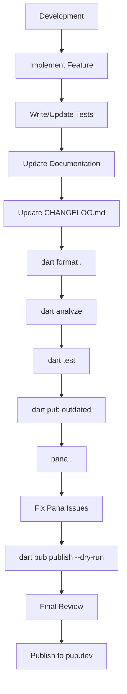

# Pub.dev Maximum Score Compliance Guide

- **Document Type:** Technical Documentation
- **Platform:** pub.dev
- **Target Score:** 160/160 Pub Points
- **Applicable To:** Dart and Flutter Packages
- **Status:** Development & Pre-Publication Checklist

---

## 1. Introduction

This document provides a comprehensive guideline for preparing a Dart or Flutter package for publication on [pub.dev](https://pub.dev) and achieving the maximum available Pub Points score of 160/160.

Pub.dev evaluates packages using automated analysis performed by **Pana**. The scoring system evaluates multiple aspects of package quality, including documentation, platform compatibility, code quality, dependency management, and adherence to Dart package conventions.

The objective of this document is to provide a repeatable process that developers can follow before publishing a package.

---

## 2. Pub.dev Scoring Overview

Pub.dev evaluates packages across six major areas:

| Category | Objective |
| :--- | :--- |
| **Documentation** | Ensure the package is properly documented and easy to understand |
| **Platform Support** | Ensure supported platforms are correctly declared and implemented |
| **Code Quality** | Maintain clean, analyzable, idiomatic Dart code |
| **Dependencies** | Use current and compatible dependencies |
| **Package Structure** | Follow recommended Dart package conventions |
| **Toolchain Compatibility** | Maintain compatibility with current Dart/Flutter tooling |

The maximum score is **160 / 160 Pub Points**.

A package does not need to be popular or have a large number of downloads to achieve 160 points. Pub Points primarily measure the technical quality and maintainability of the package.

---

## 3. Pana Analysis

### 3.1 What is Pana?

**Pana** is the automated package analysis tool used by [pub.dev](https://pub.dev) to evaluate Dart and Flutter packages.

Before publishing a package, developers should run Pana locally to identify potential issues.

**Install Pana:**

```bash
dart pub global activate pana
```

**Run Pana against the package:**

```bash
pana .
```

Alternatively, Pana can analyze a package directory:

```bash
pana path/to/package
```

The generated report identifies issues that may affect the Pub Points score.

---

## 4. Pre-Publication Project Structure

A package should follow a standard Dart package structure.

**Recommended structure:**

```
package_name/
│
├── lib/
│   ├── package_name.dart
│   └── src/
│
├── test/
│   └── ...
│
├── example/
│   └── ...
│
├── README.md
├── CHANGELOG.md
├── LICENSE
├── pubspec.yaml
└── analysis_options.yaml
```

### 4.1 lib/

The `lib/` directory contains the public package implementation.

The recommended approach is to expose a clear public API through the package's main library file.

**Example:**

```dart
library ibkr_sdk;

export 'src/client/ibkr_client.dart';
export 'src/models/account.dart';
export 'src/models/order.dart';
```

Implementation details can remain inside `lib/src/`.

---

## 5. Package Metadata

The `pubspec.yaml` file should contain complete and accurate package metadata.

**Example:**

```yaml
name: example_package
description: A Dart package providing a clear and reliable API for developers.
version: 1.0.0
repository: https://github.com/example/example_package
issue_tracker: https://github.com/example/example_package/issues
homepage: https://github.com/example/example_package

environment:
  sdk: ">=3.0.0 <4.0.0"

dependencies:
  # ...

dev_dependencies:
  test: ^1.25.0
  lints: ^5.0.0
```

### Recommended metadata

Include, where applicable:
- Package name
- Description
- Version
- Repository
- Issue tracker
- Homepage
- SDK constraints
- Dependencies
- Development dependencies

The description should clearly explain what the package does. Avoid vague descriptions such as:

```yaml
description: My package
```

Prefer:

```yaml
description: A Dart SDK for interacting with the Interactive Brokers trading API.
```

---

## 6. Documentation Requirements

Documentation is one of the most important areas for achieving a high Pub Points score.

A professional package should contain:
- README
- API documentation
- Usage examples
- Installation instructions
- Configuration requirements
- Supported platforms
- Limitations
- Changelog
- License information

### 6.1 README.md

The README should allow a developer to understand and start using the package without having to inspect the source code.

**Recommended structure:**

```markdown
# Package Name

Short description of the package.

## Features

- Feature 1
- Feature 2
- Feature 3

## Requirements

List SDK, platform, or external service requirements.

## Installation

Explain how to add the package.

## Usage

Provide a complete working example.

## Configuration

Explain required configuration.

## API

Describe important APIs.

## Supported Platforms

List supported platforms.

## Error Handling

Explain common errors.

## Testing

Explain how to run tests.

## Limitations

List known limitations.

## Changelog

See CHANGELOG.md.

## License

Specify the package license.
```

---

## 7. API Documentation

Public APIs should contain Dart documentation comments.

**Example:**

```dart
/// Creates a connection to the trading gateway.
///
/// [host] specifies the gateway host.
/// [port] specifies the gateway port.
///
/// Throws [ConnectionException] if the connection cannot be established.
Future<void> connect({
  required String host,
  required int port,
}) async {
  // ...
}
```

Avoid undocumented public APIs such as:

```dart
Future<void> connect(String host, int port) async {
  // ...
}
```

Documentation comments should explain:
- What the API does
- Parameters
- Return values
- Exceptions
- Important constraints
- Side effects where relevant

---

## 8. Public API Documentation Coverage

Pub.dev evaluates documentation coverage for public APIs.

A minimum level of documentation should be maintained, and the recommended approach is to document **all public classes, methods, properties, functions, enums, and important constructors.**

**Example:**

```dart
/// Represents a trading order.
class Order {
  /// Creates a trading order.
  Order({
    required this.symbol,
    required this.quantity,
  });

  /// The instrument symbol.
  final String symbol;

  /// Number of units to trade.
  final int quantity;
}
```

This approach provides better developer experience and reduces the risk of losing documentation-related points.

---

## 9. Example Application

A package should provide a practical example demonstrating how it is intended to be used.

**Recommended structure:**

```
example/
├── README.md
└── example.dart
```

For a Flutter package:

```
example/
├── lib/
│   └── main.dart
├── test/
└── pubspec.yaml
```

The example should demonstrate actual package functionality rather than simply importing the package.

**Example:**

```dart
import 'package:example_package/example_package.dart';

Future<void> main() async {
  final client = ExampleClient();
  await client.connect();

  final result = await client.getData();
  print(result);

  await client.disconnect();
}
```

A good example should be:
- Easy to understand
- Runnable
- Representative of real usage
- Consistent with the current API

---

## 10. Static Analysis

The package should pass Dart's static analyzer without issues.

**Run:**

```bash
dart analyze
```

For Flutter packages:

```bash
flutter analyze
```

The preferred result is: `No issues found!`

Developers should resolve:
- Errors
- Warnings
- Deprecated API usage
- Unused imports
- Unused variables
- Unreachable code
- Type issues
- Lint violations

Do not suppress analyzer warnings simply to improve the score. Instead, fix the underlying problem whenever possible.

---

## 11. Dart Formatting

The source code should follow standard Dart formatting.

**Run:**

```bash
dart format .
```

For Flutter projects:

```bash
dart format .
```

You can check whether formatting is required without modifying files:

```bash
dart format --set-exit-if-changed .
```

Formatting should be part of the pre-publication verification process.

---

## 12. Lint Configuration

A package should use a suitable lint configuration.

**For example (`analysis_options.yaml`):**

```yaml
include: package:lints/recommended.yaml
```

Then run:

```bash
dart analyze
```

For Flutter projects, a Flutter-compatible lint configuration can be used.

The purpose of linting is to maintain:
- Consistent code style
- Better maintainability
- Early detection of potential problems
- Idiomatic Dart code

---

## 13. Testing

A professional package should contain automated tests.

**Recommended structure:**

```
test/
├── client_test.dart
├── model_test.dart
├── order_test.dart
└── integration_test.dart
```

**Run tests using:**

```bash
dart test
```

For Flutter:

```bash
flutter test
```

Tests should cover important public functionality, including:
- Normal behavior
- Invalid input
- Error handling
- Edge cases
- State transitions
- API response handling

Although tests are not simply a "points farming" mechanism, they significantly improve package quality and reliability.

---

## 14. Dependency Management

Dependencies should be:
- Necessary
- Maintained
- Compatible with the supported SDK
- Reasonably up to date

**Check dependencies using:**

```bash
dart pub outdated
```

For Flutter:

```bash
flutter pub outdated
```

Review outdated packages before publishing.

Avoid unnecessary dependencies because they can:
- Increase package size
- Introduce vulnerabilities
- Create compatibility problems
- Increase maintenance requirements

---

## 15. SDK Constraints

Define appropriate Dart SDK constraints in `pubspec.yaml`.

**Example:**

```yaml
environment:
  sdk: ">=3.0.0 <4.0.0"
```

The SDK constraint should accurately represent the versions your package supports.

Do not unnecessarily restrict the SDK version. For example, if the package works correctly on a newer SDK range, avoid limiting it to an older version without a technical reason.

---

## 16. Platform Support

If the package supports multiple platforms, make sure the package correctly declares and implements that support.

Depending on the package, this may include:
- Android
- iOS
- Windows
- macOS
- Linux
- Web

Do not claim support for a platform unless the package actually works on that platform.

For Flutter plugins, platform-specific implementation should follow current Flutter plugin conventions.

---

## 17. Web and Modern Toolchain Compatibility

For packages supporting the web, verify compatibility with current Dart and Flutter web tooling.

If applicable, check whether the package has compatibility with modern web compilation technologies such as WebAssembly.

For native packages, ensure platform-specific implementations follow the current recommended tooling.

The goal is to avoid relying on obsolete or deprecated mechanisms.

---

## 18. CHANGELOG.md

Maintain a clear changelog.

**Example:**

```markdown
# Changelog

## 1.0.0

- Initial stable release.
- Added client connection support.
- Added account information APIs.
- Added market data APIs.
- Added order management APIs.

## 0.9.0

- Added initial API implementation.
- Added authentication support.
```

The changelog should be updated for every published release.

---

## 19. LICENSE

The package should contain an appropriate license.

**Example:**

```
MIT License

Copyright (c) 2026 Author Name
...
```

The license should match the licensing information specified by the project.

Do not publish a package without understanding the licensing implications of the code and dependencies being distributed.

---

## 20. Package Name and Description

Choose a package name that is:
- Unique
- Descriptive
- Easy to remember
- Consistent with Dart naming conventions

Use lowercase names with underscores where appropriate.

**Example:**

```yaml
name: ibkr_sdk
```

Avoid:

```yaml
name: MyAwesomeIBKRSDK
```

The description should communicate the package's purpose in one concise sentence.

---

## 21. Versioning

Follow semantic versioning where appropriate: `MAJOR.MINOR.PATCH`

**Example:** `1.0.0`

**Increment:**
- **PATCH**: For backward-compatible bug fixes. (e.g., `1.0.0` → `1.0.1`)
- **MINOR**: For backward-compatible functionality. (e.g., `1.0.0` → `1.1.0`)
- **MAJOR**: For breaking changes. (e.g., `1.0.0` → `2.0.0`)

Avoid publishing unnecessary versions merely to increase download counts.

---

## 22. Security and Sensitive Information

Never include sensitive information in a published package.

**Do not commit:**
- API keys
- Passwords
- Access tokens
- Private certificates
- Trading credentials
- Private URLs
- Production credentials

For example, avoid:

```dart
const apiKey = 'MY_SECRET_KEY';
```

Instead, require users to provide credentials through configuration. This is particularly important for SDKs that communicate with financial APIs or external services.

---

## 23. Pre-Publication Validation

Before publishing, execute the following commands:

1. **Get dependencies:**
   ```bash
   dart pub get
   ```
   or:
   ```bash
   flutter pub get
   ```

2. **Format:**
   ```bash
   dart format .
   ```

3. **Analyze:**
   ```bash
   dart analyze
   ```
   or:
   ```bash
   flutter analyze
   ```

4. **Run tests:**
   ```bash
   dart test
   ```
   or:
   ```bash
   flutter test
   ```

5. **Check dependencies:**
   ```bash
   dart pub outdated
   ```

6. **Run Pana:**
   ```bash
   pana .
   ```

7. **Perform a dry-run publish:**
   ```bash
   dart pub publish --dry-run
   ```

The dry run is particularly important because it identifies files and metadata issues before the actual publication.

---

## 24. Final 160/160 Checklist

Use the following checklist before publishing.

### Package Metadata
- [ ] Package name is appropriate
- [ ] Description is clear
- [ ] Version is correct
- [ ] SDK constraints are appropriate
- [ ] Repository is specified
- [ ] Issue tracker is specified where appropriate
- [ ] Homepage is specified where appropriate

### Documentation
- [ ] `README.md` exists
- [ ] Installation instructions exist
- [ ] Usage instructions exist
- [ ] Working example exists
- [ ] Features are documented
- [ ] Supported platforms are documented
- [ ] Public APIs are documented
- [ ] Configuration is documented
- [ ] Errors are documented
- [ ] Limitations are documented

### Code Quality
- [ ] `dart analyze` passes
- [ ] `flutter analyze` passes where applicable
- [ ] No warnings
- [ ] No deprecated APIs
- [ ] Code is formatted
- [ ] Lints are configured
- [ ] No unnecessary code exists

### Testing
- [ ] Unit tests exist
- [ ] Important APIs are tested
- [ ] Error cases are tested
- [ ] Edge cases are tested
- [ ] All tests pass

### Dependencies
- [ ] Dependencies are necessary
- [ ] Dependencies are maintained
- [ ] Dependency versions are appropriate
- [ ] No unnecessary dependencies exist
- [ ] `dart pub outdated` has been reviewed

### Package Files
- [ ] `README.md`
- [ ] `CHANGELOG.md`
- [ ] `LICENSE`
- [ ] `pubspec.yaml`
- [ ] `lib/`
- [ ] `test/`
- [ ] `example/`

### Platform Compatibility
- [ ] Supported platforms are correctly declared
- [ ] Platform-specific implementations work
- [ ] Web support works where applicable
- [ ] Current Flutter/Dart tooling is supported
- [ ] Deprecated platform APIs are avoided

### Security
- [ ] No API keys
- [ ] No passwords
- [ ] No access tokens
- [ ] No private credentials
- [ ] No production secrets
- [ ] Sensitive configuration is externalized

### Final Validation
- [ ] `dart pub get`
- [ ] `dart format .`
- [ ] `dart analyze`
- [ ] `dart test`
- [ ] `dart pub outdated`
- [ ] `pana .`
- [ ] `dart pub publish --dry-run`

---

## 25. Recommended Release Workflow

The following workflow should be used for every release:



---

## 26. Recommended Quality Gate

A release should not be published until the following minimum conditions are satisfied:

| Check | Required Result |
| :--- | :--- |
| **Dart formatting** | Pass |
| **Static analysis** | 0 issues |
| **Automated tests** | Pass |
| **Pana analysis** | No avoidable deductions |
| **Documentation** | Complete |
| **Example** | Working |
| **Dependencies** | Reviewed |
| **License** | Present |
| **Changelog** | Updated |
| **Dry-run publishing** | Pass |
| **Sensitive information** | None |

---

## 27. Important Note About Pub Points

Achieving **160/160 Pub Points** should be treated as a quality objective rather than simply a scoring exercise.

The goal should be to produce a package that is:
- Easy to install
- Easy to understand
- Easy to integrate
- Well documented
- Properly tested
- Maintainable
- Compatible with current Dart/Flutter tooling
- Secure
- Consistent with Dart ecosystem conventions

A package that satisfies these requirements will generally be in a strong position to achieve the maximum Pub Points score.

---

## 28. Final Recommendation

Before the first production release, perform a complete Pana analysis and address every actionable issue reported by the analyzer.

The recommended final sequence is:
```bash
dart pub get
dart format .
dart analyze
dart test
dart pub outdated
pana .
dart pub publish --dry-run
```

Only after all issues have been reviewed should the package be published.

For a production SDK, especially one providing access to external services such as a trading API, documentation, examples, error handling, testing, security, and API stability should be treated as release requirements rather than optional improvements.
